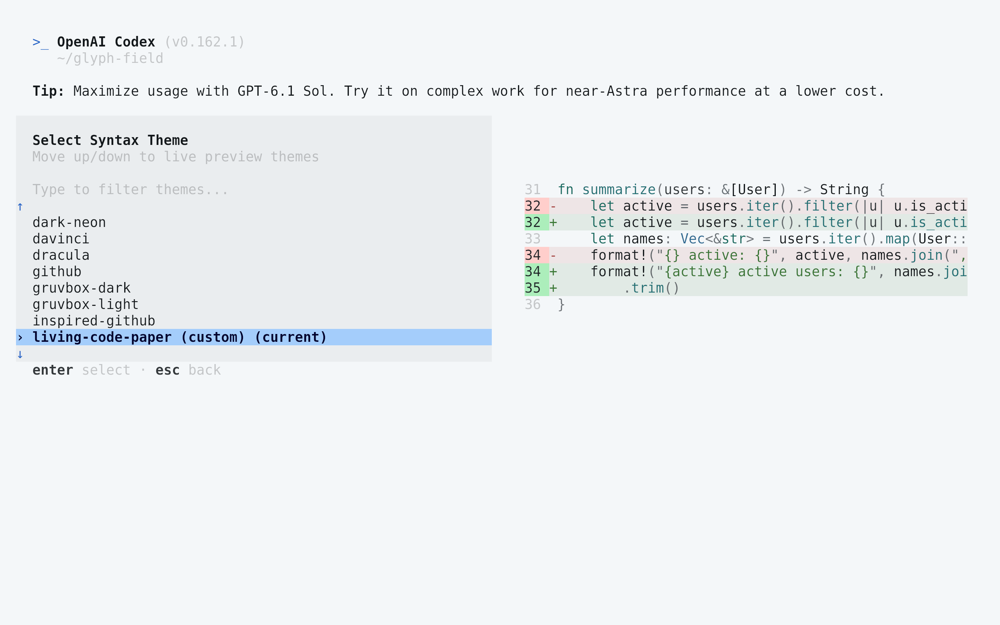
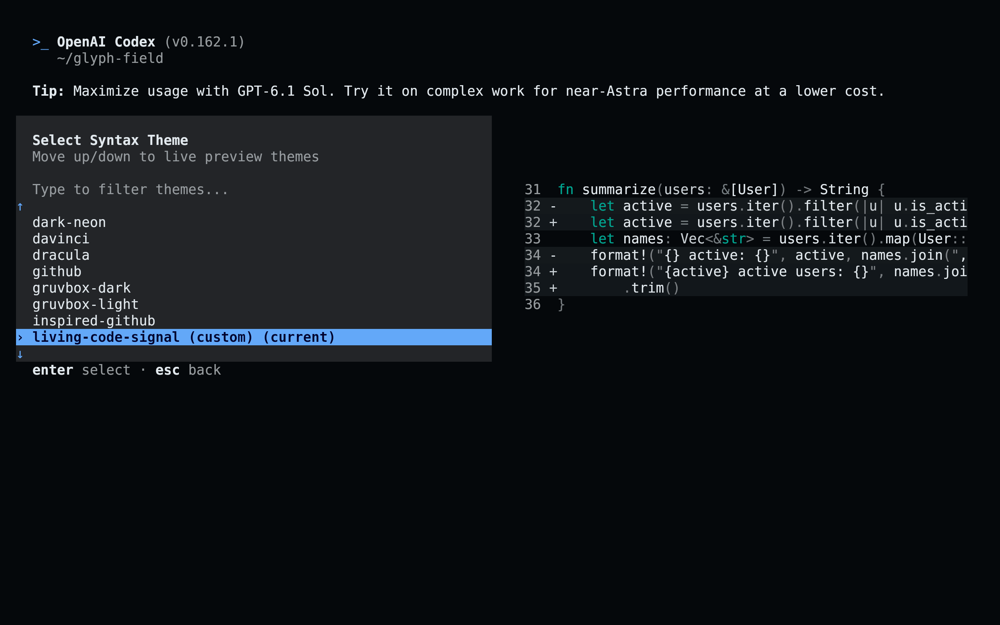

<!-- living-code-readme:1 -->
# 🤖 Living Code for Codex

**Calm slate. Living color.** Living Code for the Codex CLI: native TextMate syntax themes with coordinated Markdown, selections and added/removed diff backgrounds.

[Installation](#installation) · [Flavors](#flavors) · [Configuration](#configuration) · [All ports](https://github.com/living-code-theme)

## Previews

<table data-lc-flavors>
<tr>
<td width="50%" valign="top">
<strong>Night</strong><br><sub>Dark · full palette</sub><br><br>
<a href="images/night.png"></a>
</td>
<td width="50%" valign="top">
<strong>Frost</strong><br><sub>Dark · softer chroma</sub><br><br>
<a href="images/frost.png"></a>
</td>
</tr>
<tr>
<td width="50%" valign="top">
<strong>Paper</strong><br><sub>Light · near-white slate</sub><br><br>
<a href="images/paper.png"></a>
</td>
<td width="50%" valign="top">
<strong>Signal</strong><br><sub>Dark · teal accent</sub><br><br>
<a href="images/signal.png"></a>
</td>
</tr>
</table>

Select any preview to view the image at full size.

## Installation

```sh
flavor=night # night, frost, paper, or signal
curl -fsSL --create-dirs -o "${CODEX_HOME:-$HOME/.codex}/themes/living-code-$flavor.tmTheme" "https://raw.githubusercontent.com/living-code-theme/codex/main/themes/living-code-$flavor.tmTheme"
codex -c "tui.theme=\"living-code-$flavor\""
```

You can also choose the downloaded flavor with `/theme` in the Codex TUI. The picker persists your selection. Existing `config.toml` settings are preserved.

## Flavors

Expand a flavor for its full-size preview and activation instructions.

<details data-lc-flavor="night">
<summary><strong>Night</strong> · Dark · full palette</summary>

<p><a href="images/night.png"></a></p>

```sh
codex -c 'tui.theme="living-code-night"'
```

</details>

<details data-lc-flavor="frost">
<summary><strong>Frost</strong> · Dark · softer chroma</summary>

<p><a href="images/frost.png"></a></p>

```sh
codex -c 'tui.theme="living-code-frost"'
```

</details>

<details data-lc-flavor="paper">
<summary><strong>Paper</strong> · Light · near-white slate</summary>

<p><a href="images/paper.png"></a></p>

```sh
codex -c 'tui.theme="living-code-paper"'
```

</details>

<details data-lc-flavor="signal">
<summary><strong>Signal</strong> · Dark · teal accent</summary>

<p><a href="images/signal.png"></a></p>

```sh
codex -c 'tui.theme="living-code-signal"'
```

</details>

## Configuration

To persist a choice manually, merge `theme = "living-code-night"` into the existing `[tui]` table of `${CODEX_HOME:-~/.codex}/config.toml`. The setting uses the filename stem, not the display name or `.tmTheme` extension. Each theme specifies both `markup.inserted` and `markup.deleted` backgrounds so Codex does not fall back to unrelated diff tints.

## Compatibility

For Codex CLI versions with custom `.tmTheme` loading and the `/theme` picker. The theme is for the terminal CLI, not the Codex desktop app or VS Code extension. Codex deliberately preserves the host terminal background for ordinary code spans; pair the port with a matching Living Code terminal theme. Theme parsing and syntax scopes are tested; this does not assert that every Codex UI element is themeable.

Previews are captured programmatically from the actual application in an isolated profile. See [`capture/app.py`](capture/app.py) for the app-owned recipe and [`images/capture.json`](images/capture.json) for runtime, palette and image provenance. No mock interface is drawn.

## Contributing

Found a problem? [Open an issue](https://github.com/living-code-theme/codex/issues/new/choose) with the app version, the flavor and a screenshot. Want Living Code somewhere else? [Request a port](https://github.com/living-code-theme/core/issues/new?template=port-request.yml).

Pull requests are welcome. Keep this README, `port.json` and `images/` in sync, and use real screenshots of the app, never mockups.

🦎 **One chameleon, many habitats.** Part of [Living Code](https://github.com/living-code-theme).

## License

[MIT](LICENSE) © Elliot Luque
